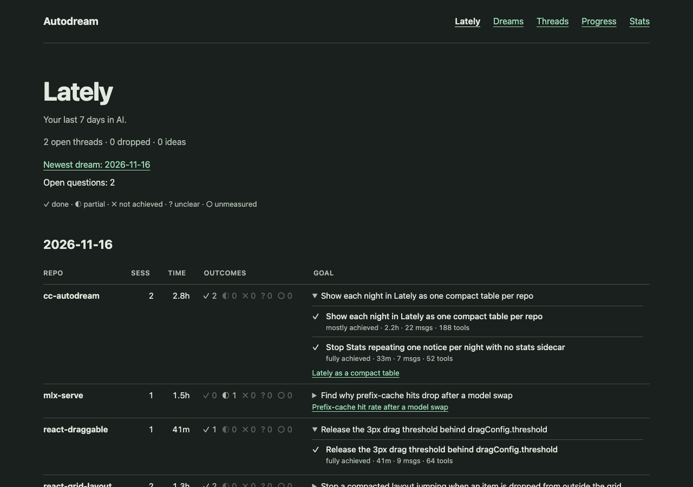
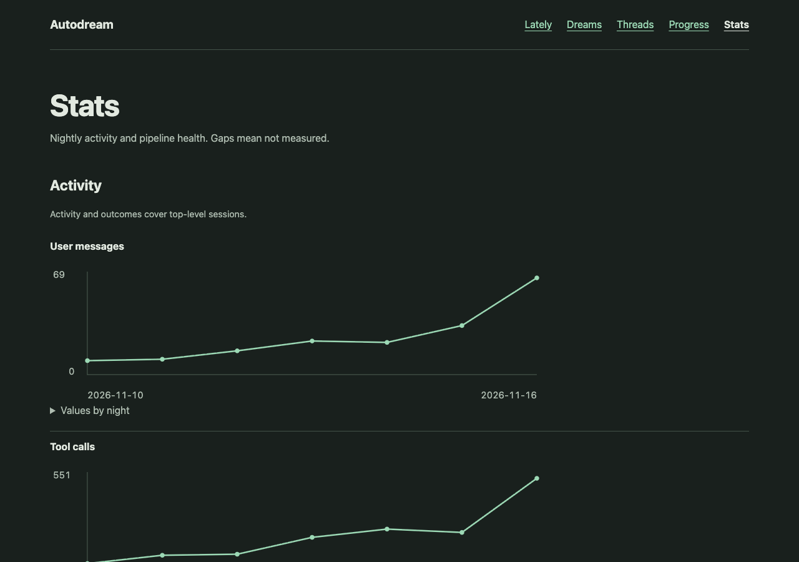

<p align="center">
  
</p>

<p align="center">
  <a href="https://github.com/STRML/autodream/actions/workflows/tests.yml"></a>
  <a href="https://github.com/STRML/autodream/actions/workflows/launchd.yml"></a>
  <a href="LICENSE"></a>
  
  
  <a href="https://strml.github.io/autodream/"></a>
</p>

**autodream reads yesterday's Claude Code and OMP sessions overnight and leaves one ranked report: what keeps going wrong, what you dropped, and what is worth remembering.**

[What you wake up to](#what-you-wake-up-to) · [How it works](#how-it-works) · [Quick start](#quick-start) · [Dashboard](#dashboard) · [Configuration](#configuration) · [Safety](#safety-and-sandboxing) · [FAQ](#faq)

## What you wake up to

A dated markdown report in `~/.claude/dreams/`, a file of open questions that opens in your editor, and a dashboard on `127.0.0.1`. The shape of the report (the numbers are illustrative, the headings and fields are the real ones):

```markdown
## Activity snapshot
- 21 sessions (18 top-level, 3 nested workers under 2 parents) across 6 projects
- Outcomes: 12 fully, 3 mostly, 1 partial, 2 unclear

## Upstream harness changes
### Claude Code
- **2.x.y** - added `--foo` -> relevant to the deploy script in project X
No releases in the window: Codex, OMP.

## Top patterns (ranked)
### Editing files before reading them
- **Category**: tool_loop
- **Count**: 6
- **Severity**: high
- **Examples**: "File has not been read yet" in six sessions, with paths
- **Proposed action**: pin "Read a file in-session before the first Edit"
- **Grounded against**: the file the proposal would change, with file:line
- **Confidence**: high
- **Pin proposed**: yes

## Open questions for the user
1. **Read-before-Edit reminder** - add one to the project CLAUDE.md?
<!-- autodream:open-questions=1 -->
```

The report also carries per-project notes, skill coverage gaps and a self-audit of the pipeline. Conditional sections cover operator notes, command output you asked for, ideas from X bookmarks and repos worth triaging. A longer one is in [`example/2026-05-25.md`](example/2026-05-25.md).



The dashboard's front page, on made-up data. [Click through the demo](https://strml.github.io/autodream/) to see every view.

## How it works

<p align="center">
  
</p>

```text
03:15  run.sh DATE
       enumerate sessions    keep those with a record inside the local day
       L1: one cheap-model call per session       -> findings/DATE/<hash>.json
       rollup: the runner counts sessions, categories, failures
                                                  -> rollup.tsv, categories.tsv
       L2: one aggregator call, tools Glob + Read -> report on stdout
       run.sh writes dreams/DATE.md, pins to Mnemopi, threads.jsonl, the notification
```

| Part | Role |
|---|---|
| Layer 1, `prompts/SESSION_TRIAGE.md` | Reads one transcript, writes one findings JSON. Default model on the claude engine is `claude-haiku-5-5` at effort `high` (`deepseek/deepseek-flash` on omp) |
| Layer 2, `prompts/PROMPT.md` | Reads every findings file, ranks by frequency and severity. No Write tool: the runner parses its stdout |
| Adapters, `adapters/<name>/` | The only code that knows a harness. `claude` and `omp` ship, and a new harness is one directory |
| State | Everything is on disk and every step is idempotent, so any date can be rebuilt |

## Features

| Feature | What it does | Details |
|---|---|---|
| Every Claude config dir | Scans each `~/.claude*/projects`; asks once whether to index each | `bin/root-probe.sh`, `SESSION_ROOTS` |
| OMP sessions | Reads the live branch of OMP's append-only session tree | `adapters/omp/` |
| Remote hosts | One-way rsync of another machine's transcripts before the scan | [Remote hosts](#remote-hosts) |
| Report-day window | Places a session by the timestamps inside it, not its file mtime | `bin/session-window.sh` |
| Long sessions | Opt-in chunked triage reads a long transcript in sequential chunks instead of its head and tail (past `AUTODREAM_L1_MAX_CHUNKS` the middle chunks are dropped) | `AUTODREAM_L1_CHUNK_BYTES` |
| Ranked report | Frequency times severity; eval sandboxes count at a quarter weight | `prompts/PROMPT.md` |
| Grounded proposals | A proposal that edits a file must cite the `file:line` it read | `prompts/PROMPT.md` |
| Open questions | `review.sh` walks them one at a time; a question asked three reports running is flagged | `bin/review.sh`, `bin/question-streaks.sh` |
| Memory pins | High-confidence findings become Mnemopi memories | `bin/apply-pins.sh` |
| Dropped threads | A cross-day index of work that stopped before it finished, plus ideas | [Dropped threads](#dropped-threads) |
| Upstream watch | Diffs the Claude Code, Codex and OMP changelogs over the day | `AUTODREAM_CHANGELOG_SOURCES` |
| Notes in | Terminal notes, a synced-vault inbox, and a focus tag on a Claude Code, OMP or Codex turn | `bin/autodream-note.sh`, `bin/autodream-focus.sh`, `mods/autodream-focus/`, `extensions/omp/` |
| Report scripts | An operator note can ask for a command's output: list the command in `$AUTODREAM_DIR/report-scripts.conf` (`<name> <path> [args...]`) and Layer 2 reads the result | `bin/report-scripts.sh` |
| X bookmarks | Idea fuel from unread bookmarks. `AUTODREAM_X_FETCH=browser` reads them through a logged-in `agent-browser` profile (log in once with `x-bookmarks.sh browser-login`) and falls back to the GraphQL path when `x-credentials` exists | `bin/x-bookmarks.sh` |
| Other extras | Finished worktree and branch pruning (opt-in, `AUTODREAM_PRUNE_ROOTS`); repos worth triaging (on by default, read-only) | `bin/prune-worktrees.sh`, `bin/triage-candidates.sh` |
| Comment ratchet | CI fails a PR that raises a file's comment count above `.comment-baseline` | `tests/comment-ratchet.sh`, `bin/comment-count.sh` |
| Self-audit | The report lists its own failures: unsynced hosts, failed workers, unconfined runs | `run-stats.txt` |

## Quick start

You need macOS and the `claude` CLI. The runner calls `$HOME/.local/bin/claude` unless `CLAUDE_BIN` in the config names another path. The nightly schedule is a launchd job.

```bash
git clone https://github.com/STRML/autodream ~/git/autodream
cd ~/git/autodream
./install.sh --dry-run                               # print every change, make none
./install.sh                                         # Claude Code only
./install.sh --adapters claude,omp --l2-engine omp   # both harnesses, OMP runs L2
```

Install symlinks the scripts in `bin/`, the files in `prompts/`, `adapters/` and `web/` into `~/.claude/autodream/`, so editing the repo takes effect at once. It also installs the nightly job, a review agent and the dashboard service. `--no-schedule`, `--no-review`, `--no-web` and `--no-skill` skip one each.

Run the first night yourself instead of waiting for 03:15:

```bash
~/.claude/autodream/autodream-now.sh --watch              # yesterday; exits 1 if no report lands
~/.claude/autodream/autodream-now.sh 2026-05-29 --force   # rebuild a date
~/.claude/autodream/autodream-web open                    # sign in to the dashboard
~/.claude/autodream/review.sh                             # walk the latest report's open questions
```

`autodream-now.sh` hands the run to launchd, so a closed terminal or a task time limit cannot kill it. In any Claude Code session, `/autodream` prints what is waiting, starts yesterday's run and walks the unanswered questions of older reports.

launchd does not wake a sleeping Mac. To guarantee the 03:15 trigger, run `sudo pmset repeat wake MTWRFSU 03:10:00`. Catch-up triggers at 06:15, 09:15 and 12:15 cover the rest, and they do nothing once a date has its report.

### Remote hosts

Name each host in `~/.claude/autodream/config`. An entry is `label=ssh-target:path`, entries are separated by spaces, and the path is relative to the remote home:

```bash
AUTODREAM_REMOTE_ROOTS="studio2=studio2:.claude/projects"
```

The pull is read-only on the remote and needs only sshd and a login that works without a prompt. A host that is down costs only its own sessions. The report names it, and a warning banner fires when every host fails.

### Dropped threads

The nightly run links sessions into `~/.claude/autodream/threads.jsonl`. An open work thread whose newest session ended unfinished shows as dropped after `AUTODREAM_THREADS_DROPPED_DAYS` (default 7) of silence. Ideas are never dropped.

```bash
~/.claude/autodream/threads.sh list
~/.claude/autodream/threads.sh move t-0123abcd done      # or open, or idea
~/.claude/autodream/threads.sh resume t-0123abcd --launch
```

## Dashboard

`autodream-web` serves five views on `127.0.0.1:47823`: Lately, Dreams, Threads, Progress and Stats. Requests need the canonical Host and a session cookie, and `autodream-web open` signs you in. Stats shows a gap, never a zero, for anything that was not measured.



`docs/screenshots/fixture.py` writes the made-up install behind both screenshots, and `docs/demo/build.py` builds the [Pages demo](https://strml.github.io/autodream/) from it. Design notes: [`docs/design/autodream-web-2026-11-15.md`](docs/design/autodream-web-2026-11-15.md).

## Configuration

Put settings in `~/.claude/autodream/config` as plain `KEY=value` bash (see [`example/config.example`](example/config.example)). An exported environment variable wins over the file. The full list is in [`docs/run-knobs.md`](docs/run-knobs.md).

| Variable | Default | Effect |
|---|---|---|
| `AUTODREAM_ADAPTERS` | `claude` | Harnesses a run scans: names, or `all`. `install.sh --adapters` writes it |
| `AUTODREAM_L2_ENGINE` | first enabled adapter | Engine that runs Layer 2, and Layer 1 too unless `AUTODREAM_L1_ENGINE[_<NAME>]` says otherwise |
| `AUTODREAM_L1_MODEL_<NAME>`, `AUTODREAM_L2_MODEL_<NAME>` | the adapter manifest's model | Pin a model per engine |
| `AUTODREAM_L1_EFFORT` | `high` | Claude Layer 1 effort: `low`, `medium`, `high`, `xhigh`, `max` or `off` |
| `FANOUT` | `8` | Layer 1 workers in parallel |
| `AUTODREAM_L1_TIMEOUT` | `1200` | Seconds before a worker and its process group are killed |
| `AUTODREAM_L1_ROUNDS` | `5` | Retry rounds for sessions with no findings |
| `AUTODREAM_L1_CONFINE` | `1` | `0` runs workers without the OS sandbox |
| `AUTODREAM_L1_CHUNK_BYTES` | `0` (off) | Split a transcript larger than this into chunks. A long session costs up to `AUTODREAM_L1_MAX_CHUNKS` (8) calls, plus a retry for each failed chunk |
| `AUTODREAM_WINDOW` | `1` | `0` places sessions by file mtime alone |
| `SESSION_ROOTS` | every indexed `~/.claude*/projects` | Colon-separated roots; `install.sh` writes the indexed set |
| `AUTODREAM_REMOTE_ROOTS` | unset (off) | Hosts to pull, as above |
| `AUTODREAM_CHANGELOG` | `1` | `0` skips the upstream changelog check |
| `AUTODREAM_VAULT_DIR` | unset (off) | A synced-vault folder: note inbox, and a copy of each report |
| `AUTODREAM_PRUNE_ROOTS` | unset (off) | Repo roots whose provably finished worktrees and branches are removed nightly |
| `AUTODREAM_TRIAGE_SURFACE` | `inline` | `cmux` opens the question walk-through in its own workspace |
| `AUTODREAM_THREADS_DROPPED_DAYS` | `7` | Days of silence before an open thread counts as dropped |
| `AUTODREAM_QUESTION_ESCALATE_AT` | `3` | Consecutive reports before a repeated question is escalated |
| `AUTODREAM_REQUIRE_LOGIN` | record only | For example `provider=firstParty auth=claude.ai`. A Layer 1 engine that does not match triages nothing, and a Layer 2 engine that does not match stops the run |
| `AUTODREAM_L1_REQUIRE_SERVED` | `0` | `1` discards a Layer 1 answer from a model other than the one requested |
| `AUTODREAM_WEB_PORT` | `47823` | Dashboard port |
| `AUTODREAM_WEB` | on | `0` makes `install.sh` skip the dashboard service (`--no-web` does the same) |
| `AUTODREAM_FORCE` | `0` | `1` rebuilds a date that already has a report |

## Safety and sandboxing

Transcripts hold whatever your sessions held, including text from web pages and tool output. The pipeline assumes a transcript can contain instructions aimed at the model reading it, and limits what that model can do.

```text
L1 engine call
  runs under    sandbox-exec (macOS) or bwrap (Linux)
  can write     its own staging dir under $AUTODREAM_DIR/staging/, plus the engine's short write list (claude: its CLI cache; omp: none)
  cannot write  findings/, dreams/, $AUTODREAM_DIR, config, settings, hooks, skills, plugins
  runner        copies the answer out after the engine exits, only if it is a regular file
```

| Boundary | What holds | When it cannot |
|---|---|---|
| Layer 1 writes | The sandbox above. Reads, network and exec are unchanged, because a worker must read the transcript and reach its provider | No working sandbox: workers run unconfined, `run-stats.txt` says `l1_confined: no`, and the log warns. An engine whose adapter declares no write list (`l1-writes`) is reported as `l1_confined_<engine>: no`. The claude and omp adapters both declare one, so both engines are confined |
| omp Layer 1 state | Each confined omp worker runs with a throwaway `HOME` inside its stage. The databases are copied there with the OAuth credential rows left out, so a worker cannot rotate your refresh token. omp's memory backend is off for these calls | A model whose only credential is OAuth leaves omp unconfined (`l1_confined_omp: no`, with the reason) |
| Layer 1 probe | Each run checks that a write beside the staging dir is refused | A tool that accepts a profile and confines nothing counts as no sandbox |
| Layer 2 | `Glob` and `Read` only, on both engines. The runner takes the report from stdout only when the end sentinel is present, and pins only from a closed block after it | A capture with no sentinel is kept as a partial and retried |
| Pins | `apply-pins.sh` refuses a pin for a project with no sessions that night, and keeps a ledger so a rerun skips a stored pin | A failed call writes no ledger row, so a rerun retries it. A pin stored but not recorded (`unledgered`) is stored again by a rerun |
| Counts | Session, category and failure tallies come from `rollup.tsv`, built from the runner's own session rows | A model's number never replaces one of these |
| Self-pollution | Workers run with `--no-session-persistence`, from a working directory that is wiped before and after, and enumeration drops any transcript whose first turn is one of autodream's own prompts. Without these, 215 sessions were enumerated on 2026-05-29 against 21 real ones | Older stubs in the real bucket are removed by `bin/prune-self-sessions.sh --delete` |
| Dead network or refusing provider | The date is left unassembled and a later trigger retries it, so no report is built from a short corpus | A remote host that fails to sync does not defer the date: the report names the host and a finished report is not rebuilt |

The sandbox bounds what a worker can write. Layer 2's grounding and triviality gates check what a bad transcript can make a worker say, so read open questions before you approve anything. Layer 1 workers run with `bypassPermissions`: do not run autodream in a shared environment.

## FAQ

### Do my transcripts leave the machine?

Yes, to the model provider of the engine you configure: Anthropic through the `claude` CLI by default, OMP's configured provider for the `omp` engine. Remote hosts are pulled to your machine over ssh and read from the local copy.

### What does it cost?

The repo has no measured nightly total, because it scales with how many sessions you ran. One data point: a real triage run on a 250 KB slice cost $0.159 with Layer 1's replaced system prompt, against $0.215 before it (2026-10-07). Chunked triage is off by default because it multiplies calls on long sessions. `run-stats.txt` records the calls made.

### Does it read Codex sessions?

Not today. Codex is in the upstream changelog watch only. A Codex adapter would be a new directory under `adapters/`.

### Does it run on Linux?

The pipeline and its tests do: Linux CI runs the suite against a mock engine. Install, the launchd schedule, notifications and the review agent are macOS. On Linux there is no nightly job, notification or review agent. `./install.sh --no-schedule --no-review --no-web` links the scripts and prompts into `~/.claude/autodream/` (CI runs the install suites on macOS only), and you run `~/.claude/autodream/run.sh DATE` from your own scheduler.

### What if the Mac is asleep at 03:15?

launchd runs the job on the next wake and the later triggers cover the morning. A date that already has a report makes the rest a one-second no-op.

### How do I rebuild a date?

`autodream-now.sh DATE --force`. For a clean start, remove that date's `findings/` directory and its report first.

### How do I add a harness?

Add `adapters/<name>/` with `manifest.json`, `adapter.sh` (enumerate, normalize, project, stats, slim, is-self, skills-inventory) and `facts.md`. The contract is in [`docs/design/unify-harness-adapters-2026-08-23.md`](docs/design/unify-harness-adapters-2026-08-23.md), and `tests/adapter-contract.sh` checks it.

### How do I leave a note for tonight's run?

`autodream-note.sh "evaluate how often /graphify fires"`, or drop a markdown file in `<vault>/inbox/` from your phone. The report answers it under Operator notes, and a note is archived only after a report read it.

## How it's built

Bash 3.2 for the pipeline, so it runs under macOS's stock shell. Python for the dashboard's data layer and server. TypeScript for the optional Claude Code mods in `mods/` and the OMP extension in `extensions/omp/`.

| Where | What |
|---|---|
| [`CLAUDE.md`](CLAUDE.md) | The agent map: operating notes for working on this repo |
| [`codemaps/architecture.md`](codemaps/architecture.md) | Data flow and file map |
| [`docs/design/`](docs/design/), [`docs/plans/`](docs/plans/) | Design notes and implementation plans |
| [`docs/adr/`](docs/adr/) | Decision records for the code |
| `tests/run-all.sh` | Drives the real `run.sh` against a mock engine: no network, no model. `RUNALL_SHARD=i/n` splits it, and `tests/run-parallel.sh` runs the shards locally |
| `mods/autodream-band`, `mods/autodream-focus` | Optional Claude Code mods: a band above the prompt when a report has open questions, and a button that tags a turn for the next run. Load with `claude --plugin-dir` |

## License

MIT. See [LICENSE](LICENSE).
